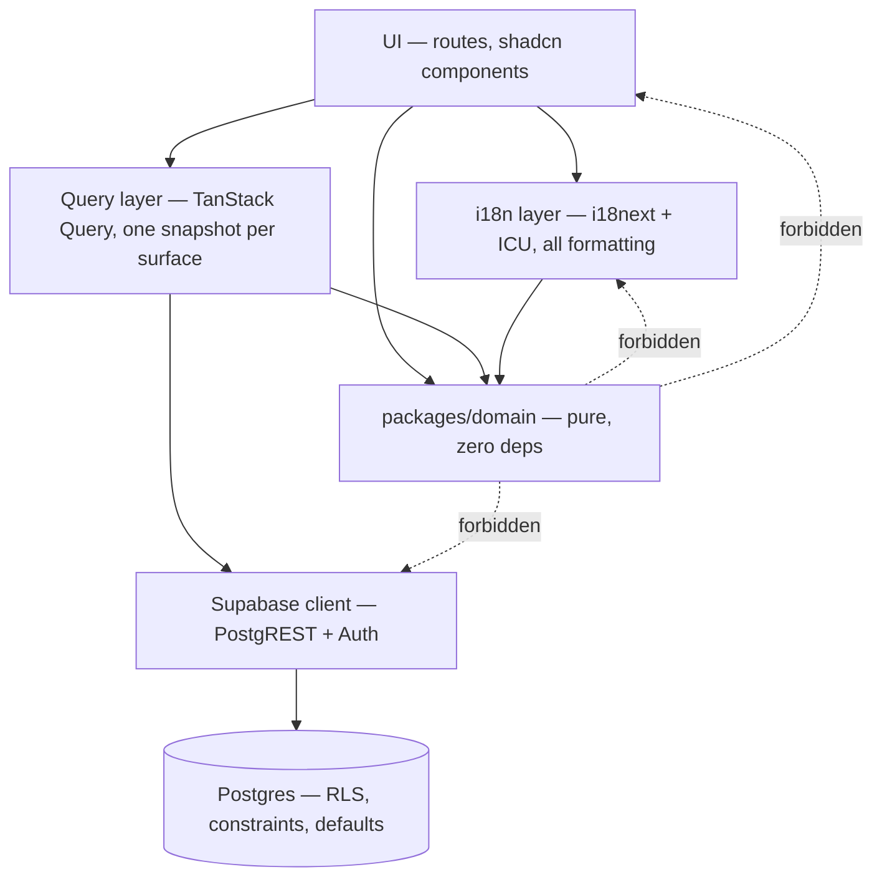
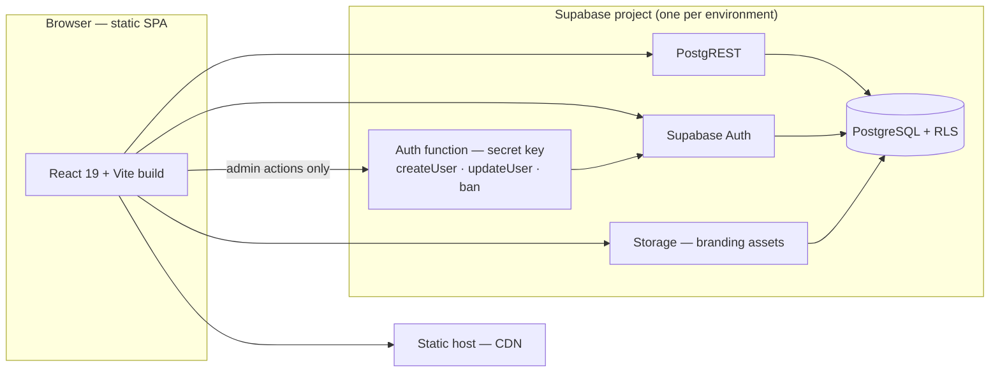
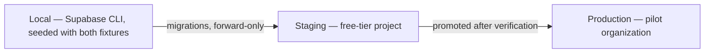
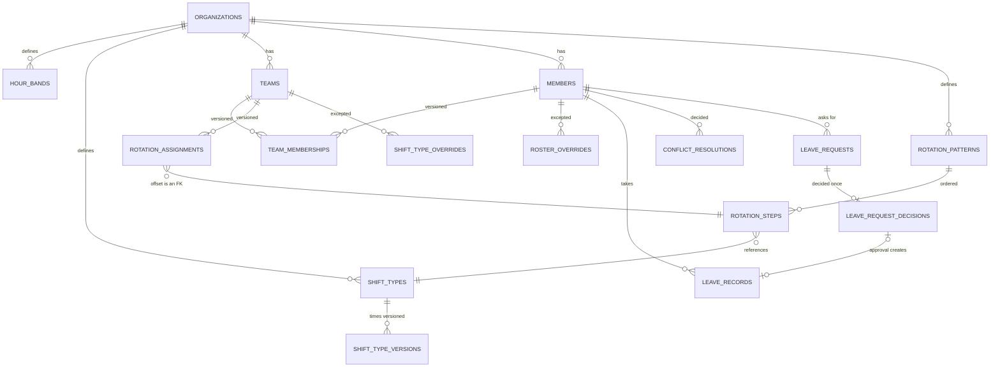

# Architecture Spine — Shift

## Design Paradigm

**The database stores only what a human asserted; everything else is a pure function of it.**

Three kinds of row exist, and nothing else does:

| Kind | Contents |
| --- | --- |
| **Rules** | organization settings, hour bands, shift types, teams, members, allowances, rotation patterns and steps, rotation assignments |
| **Exceptions** | shift-type overrides, roster overrides, leave records |
| **Decisions** | conflict resolutions, each with its attribution |

Everything a user reads is derived from those: the projected schedule, shift rosters, band hours, total hours, leave-day counts, leave balances, leave/schedule collisions, and coverage and rest-gap warnings.

The derivation lives in one pure package that cannot reach for data. The store enforces who may assert what. There is nothing in between.

## Invariants & Rules

### AD-1 — Nothing derived is ever persisted

- **Binds:** all; CAP-11, CAP-13, CAP-14, CAP-15, CAP-16
- **Prevents:** one unit reading a materialized row while another recomputes, and the two disagreeing — the drift that makes DI-1 and DI-2 unverifiable.
- **Rule:** No table may hold a value the domain package can compute. Adding a column that caches a derived figure requires amending this AD, not a migration.

### AD-2 — Every rule that feeds derivation declares whether it is versioned or current-state

- **Binds:** CAP-3, CAP-4, CAP-6, CAP-8, CAP-9, CAP-11; engine-rules R1.1, R1.2, R2.10, R7.4
- **Prevents:** history silently rewriting itself. Under AD-1 there are no stored shifts, so a rule edit re-derives *every past date* through the new value by default — which quietly violates CAP-4's "alters no past shift", CAP-6's "forward only, rewrites no history", and CAP-9's "shifts before the effective date are unchanged".
- **Rule:** Retroactivity is never incidental. Each rule kind is classified below, and a versioned rule carries a validity range, is never updated in place, and is selected by the date being derived.

  | Rule | Classification | Because |
  | --- | --- | --- |
  | Rotation assignment | **Versioned** | CAP-9 — shifts before the effective date are unchanged |
  | Team membership | **Versioned** | CAP-6 — a team move changes the schedule forward only |
  | Member active status | **Versioned** | CAP-4 — deactivation removes from *future* rosters and alters no past shift |
  | Rotation pattern and steps | **Versioned** | reached through a versioned assignment; editing in place would defeat it |
  | Shift type **times** | **Versioned** | an edit would otherwise change accepted totals for closed months, and there is no period locking to catch it |
  | Shift type **name** | **Current-state** | a rename is cosmetic; versioning it would churn the hot path for a typo fix |
  | Hour bands | **Current-state** | CAP-3 explicitly *wants* retroactivity — moving a boundary recomputes reported band hours, and changes no total |
  | Leave allowance | **Current-state** | CAP-15 — allowance minus used equals balance at all times |
  | Team position | **Versioned** (on the team-membership version) | a promotion takes effect from a date; the roster for a past date shows the position then held (added 2026-09-25, sprint change) |
  | Member fire rank | **Current-state** | descriptive only, like shift type name; nothing derived reads it (added 2026-09-25, sprint change) |

  A new rule kind is unclassified until it appears in this table.

### AD-3 — Illegal states are made unrepresentable, not validated

- **Binds:** CAP-3, CAP-4, CAP-8, CAP-15, CAP-19; engine-rules R1.5, R1.6, R4.4, R9.4; quality-requirements Q6
- **Prevents:** a guard existing only in client code, so a direct PostgREST call writes a state the engine cannot interpret.
- **Rule:** Prefer schema shape to a check. Hour bands store a name and start time only, windows derived. A rotation offset is a foreign key to a step **of that pattern**, never an integer. Overlapping leave is refused by `EXCLUDE USING gist (member_id WITH =, during WITH &&)`, which requires the `btree_gist` extension. A validation that could have been a shape is a defect.
- **Named exception:** Q6 — an organization may never be left with zero admins and the last admin's role may not be downgraded — is the one refusal that *cannot* be made unrepresentable, because it is a cross-row cardinality rule. It is enforced by a constraint trigger, and it is the only constraint trigger and the only cardinality rule enforced by trigger that is permitted. A second one is a signal that AD-9's no-server-tier decision needs revisiting, not that another trigger should be written. The one other refusing trigger is the named, non-computing exception below (story 9.2); any further refusing trigger needs its own named exception here.
- **Named exception (story 9.2, human decision 2026-10-27):** a leave request may not share a date with its member's live leave (R9.4). The rule crosses `leave_requests` and `leave_records`, and no exclusion constraint can span two tables, so the BEFORE INSERT row trigger `refuse_leave_request_over_leave()` (0040) refuses it with 23P01 and the message `LEAVE_REQUEST_OVERLAPS_LEAVE`. It computes nothing: it reads whether a live leave range of the same member overlaps the new one. It acts only for a request session whose caller is an active account inserting for its own member row, and leaves every other insert to the policy's 42501. The overlap between two pending requests of one member stays schema shape: `EXCLUDE USING gist (member_id WITH =, during WITH &&) WHERE (closed_at IS NULL)`. An admin's direct leave record is never refused because a pending request overlaps it; the approval then aborts on the leave exclusion.
- **Amended 2026-10-30 (retro 8–9 item 17, 0047; recording 0041 too).** The same trigger, behind the same gates, also refuses a request reaching a date on which its member is inactive (55000 `LEAVE_REQUEST_MEMBER_INACTIVE`, 0041) and, first, a request whose first day is before `organization_today(organization_id)` (55000 `LEAVE_REQUEST_IN_PAST`, product owner decision 2026-10-30): a member requests leave from today on, and past leave is an admin's leave record, which no rule here touches. Each compares the new row with a fact read as it stands (the organization's date in its own zone, the member's status, a live range); none derives a schedule or a balance, and none is a new trigger. What became of an approved request's leave record (amended or removed since) is derived on read by the SECURITY INVOKER computed field `leave_record_change(leave_request_decisions)`, and is no stored state.

### AD-4 — A conflict is derived; only its resolution is stored

- **Binds:** CAP-16, CAP-19; engine-rules R6.1–R6.5; quality-requirements Q11
- **Prevents:** a missed recomputation path producing a silent false negative — the exact failure the product exists to prevent — and stale conflict rows surviving a rotation change as false positives.
- **Rule:** No conflicts table. A collision is `leave ∩ working shift ∩ roster`, computed on read. A `conflict_resolutions` row keyed by `(organization_id, member_id, date, team_id)` records the kind, the shift type the key had when it was decided (`shift_type_id`, since 0038; null on older rows), the acting admin, and the timestamp — `team_id` is load-bearing, because a roster override can place a member on another team's shift on a date they already work, producing two distinct collisions the same day; replace-member and amend-leave also reference the override or leave change they caused. An unresolved conflict is a derived collision with no matching resolution. A replace-member resolution matches only while the override it references is live, in force and applied on that date (story 5.5d, decided in the browser, never by a roster computed in the database); removing that override ends the resolution in the same call (0033), so the key can be decided again. A resolution with a stored shift type matches only while the team's schedule has that same type on its date today (0038, decided in the browser's one resolution filter, `effectiveResolutionsOf`), so a decision left dormant when its key stopped colliding never re-applies to a different shift; a row with no stored type matches by key alone. A new decision on the key naming another type supersedes the stored one in the same insert (soft-removed, attributed to the new decision's author), comparing stored values only, so the database still derives no schedule.
- **Amendment (story 9.2):** *Za odluku* is a union of three sets: derived collisions that have no resolution, pending leave requests, and (in Epic 12) pending swap requests. Requests are stored rows (`leave_requests`, 0040), and only a decision clears one: `decide_leave_request` writes one `leave_request_decisions` row per request, keyed by the request, and the member's `withdraw_leave_request` closes it with no decision. A request's status is derived and never stored twice: pending is `closed_at IS NULL`, approved or rejected is the decision's `outcome`, and a closed request with no decision is withdrawn. A pending request derives nothing: it is no leave record, so it raises no collision and charges no balance. An approval only adds leave, so it can add collisions and erase none, and AD-5's erasure diff does not apply to it. There is still no conflicts table.

### AD-5 — A configuration change diffs the collision set and surfaces what it would erase

- **Binds:** CAP-9, CAP-16; engine-rules R6.3
- **Prevents:** a rotation or roster change silently deleting an unresolved conflict an admin had queued — the failure mode AD-4 opens up.
- **Rule:** Any write that can change the projected schedule computes the unresolved collision set before and after, and surfaces every erased collision for explicit confirm, amend, or discard. The change is not applied until they are dispositioned. This never blocks on warnings — only on erasures. The diff is bounded, not unbounded over all future dates: a collision requires a leave record, so the window is the union of existing leave ranges intersected with the change's own validity range. As shipped for the rotation save (story 5.5a): `domain/collisions` owns the bound (`leaveRecordsFrom`, leave clipped to the change's effective date onward) and the set difference (`erasedCollisionsOf`, unresolved keys before minus after, through the one resolution filter); "after" is the snapshot with the draft's versions and a save stamp newer than every override, so overrides from the effective date go pending as a real save makes them. Added collisions are never erasures. Each erasure is confirmed row by row in the save's dialog; nothing is recorded. A diff that cannot be derived refuses the save. Since story 5.5b the calendar roster overrides are guarded too, saving a change and removing one, through the same diff and dialog. Since story 5.5e so are the member page's team move (to another team or to no team, and withdrawing a scheduled move) and status change (deactivation, and withdrawing a scheduled reactivation): "after" changes only that member's versions, and a version already dated the day, a scheduled version gone or a missing or archived team is the write's own refusal. Since story 5.5f so are the calendar's shift-type overrides, setting one in the day detail and removing one: one surface-neutral "after" covers every override write (a set appends an override newer than every instant and unconfirmed; a removal filters it out; a confirm stamps it newest; an amend replaces it with a newest one of the new type), and a live override already on the team and date, an override gone, or an archived team or type is the write's own refusal. Every removal is checked against the fresh read; one pending review there is not applied, lists nothing, and removes at once. A set's preflight is run again on the day as the check read it. Since story 5.5g so is cancelling a scheduled rotation change: "after" is the snapshot without the active teams' versions and save stamps dated the scheduled day (an archived team's are kept, as the delete keeps them; the steps stay; no stamp is added, so the overrides the cancelled stamp had made pending are in force again), the diff runs from the scheduled date, and a calendar and rotation read that disagree on the active teams or on the scheduled versions themselves (team, pattern, offset step, anchor) cannot be checked. A fresh rotation that no longer schedules the confirmed date, or a dialog saved after the organization's day has turned, is the cancel's own stale refusal; a landed cancel re-reads the calendar, the leave and the resolutions. Since story 5.5h so is the rotation builder's override review, confirming or amending an override a rotation change left pending: the same surface-neutral "after" (a confirm stamps it newest; an amend replaces it with a newest one of the new type), the override matched by id in the fresh calendar and the diff run from its date. The row's own offers (no version governs the date) and the amend's preflight refuse first, with no check; an override gone, an archived team or type, or (for a confirm since 0035, and for an amend since 0036) a version governing the override's date other than the one the review was derived from is the review's own stale refusal. A landed confirm or amend re-reads the calendar, the leave and the resolutions beside the rotation. Discarding a pending override is never checked, since it is not applied. Since 0039 the same review disposes of a pending roster override, guarded the same way: a confirm (`confirm_roster_override`) stamps it newest, and an amend of who arrives (`amend_roster_override`, the member taken off kept) replaces it with a newest one putting the new member on, both in the calendar roster guard's "after" (5.5b's), the override matched by id and the diff run from its date. Both definers take the organization lock and carry the governing version's save time, as 0035 and 0036 do for the shift-type layer; an override gone, an archived team, the new member already put on by another live change, or another governing version is the review's own stale refusal. An amend moves the live `replace_member` resolution linked to the old row onto the new one; a removal still ends it. The roster override's pending rule reads `confirmed_at ?? created_at`, as the shift-type layer's does.

### AD-6 — Time is integer minutes since midnight, over nominal wall-clock

- **Binds:** CAP-3, CAP-7, CAP-14; engine-rules R3.1–R3.10; DI-5, DI-6
- **Prevents:** the whole daylight-saving class of bug, and a second unit reaching for elapsed real time because it was available.
- **Rule:** No `Date`, no `timestamptz`, and no instant enters a calculation. Shift types store `start_time`/`end_time` as `time` plus `is_working`; nominal duration is derived (`end <= start` means it crosses midnight, add 1440). Instants are computed for display in the organization timezone only, and never for accounting.

### AD-7 — One pure domain package, and it cannot reach for data

- **Binds:** all; quality-requirements Q7, Q8
- **Prevents:** the same calculation existing in a component, a query hook, and a Postgres function, agreeing today and diverging later.
- **Rule:** `packages/domain` holds every calculation, as pure TypeScript with zero runtime dependencies, no React import, no Supabase import, and no I/O. Its shape is `(config snapshot, exception layer, window) -> derived values` over plain data. It is a leaf: everything may depend on it, it depends on nothing. Recomputing outside it is a defect even when the answer matches.

### AD-8 — The domain returns codes and operands, never prose

- **Binds:** CAP-10, CAP-16; localization L4, L7
- **Prevents:** a translated string originating in the engine, which makes Croatian's three plural forms unimplementable because the count never reaches the formatter as a number.
- **Rule:** Warnings, refusals, and states are data — `{ code: 'REST_GAP', hours: 24 }`, `{ code: 'COVERAGE_GAP', dates: [...] }`. The i18n layer resolves them. A domain function returning `"24 sati"` is a defect.

### AD-9 — No server tier for domain writes; clients write directly to Postgres under RLS

- **Binds:** all domain writes; quality-requirements Q1, Q2
- **Prevents:** domain logic acquiring a second home, and a service-role key bypassing the row-level policies the spec requires.
- **Rule:** Every domain write goes through PostgREST. Isolation and role are enforced by RLS, integrity by schema shape (AD-3), attribution by column default (AD-11). Any rule that cannot be expressed declaratively is escalated to this spine, not solved by adding a function. The exceptions are the two Edge Functions of AD-14, and neither writes a domain table: the privileged auth boundary of AD-16, and `notify` (AD-18), which reads and writes only through two `service_role`-only functions (`claim_notifications`, `settle_notification`) and writes only the outbox's delivery columns.
- **Amended 2026-10-30 (retro-10 batch, recording what 10.4 and 0046 shipped).** `notify` now reaches the database through four `service_role`-only functions (AD-14). Three write nothing but the outbox's delivery columns or nothing at all (`claim_notifications`, `settle_notification`, `push_devices_for_send`, the last a read). The fourth, `delete_push_subscription` (0045), is the one named exception in which `notify` writes a domain table: it deletes a single `push_subscriptions` row the push service reported gone (404, 410), and only when its id, endpoint and member all still match what the claim returned, so a device handed to another member since is never deleted. Nothing else changes. A second exception, also escalated here: `register_push_subscription` (0045) is a `SECURITY DEFINER` RPC for a member's own write. A device's endpoint is unique and may be held by another member (a shared browser, possibly another organization's), whom the caller can neither see nor delete under RLS; the definer hands the row to the caller in one statement, checks the push-service host and caps a member at ten devices. The caller is the active member of the token's organization, matched by `auth_user_id`, never a value in the request. Every other push-subscription write (read own, delete own) is plain RLS.

### AD-10 — RLS reads the organization from a claim and the role from the table

- **Binds:** CAP-1, CAP-4; quality-requirements Q1, Q2, Q3
- **Prevents:** a deactivated or demoted account retaining write access until its token expires — which all-claims policies would allow, contradicting CAP-4's "blocks authentication."
- **Rule:** `organization_id` rides in a JWT claim, safe only because one user belongs to exactly one organization. Role and active status are read on every policy evaluation through a `SECURITY DEFINER STABLE` helper. If multi-organization membership is ever added, this AD is void — see Deferred.
- **Amendment (story 9.2):** a member may insert, and withdraw, rows they own: the first member-role domain writes. As shipped in 0040, any active account (member or admin) inserts a `leave_requests` row only for its own member row, under the self-owned row policy `leave_requests_insert_own_by_active_member`: `member_id` is matched against `members.auth_user_id = auth.uid()` in the claimed organization, the organization comes from the claim and the active status from `current_member_access()`, never from the request. The member withdraws only their own pending request, through `withdraw_leave_request`. A member writes no decision, no leave record and no colleague's request; only an active admin decides, through `decide_leave_request`. Epic 12 adds answering a swap addressed to the member.

### AD-11 — Attribution comes from column defaults the client cannot forge

- **Binds:** CAP-9, CAP-12, CAP-16; DI-11; quality-requirements Q11, Q12
- **Prevents:** an unattributable or falsely attributed change — which matters more than usual because AD-9 leaves no server tier to enforce it.
- **Rule:** Every override, leave record, and resolution carries `created_by uuid default auth.uid()` and `created_at timestamptz default now()`, with an RLS `WITH CHECK (created_by = auth.uid())`. The attribution outlives what it modified. No audit-log interface exists.

### AD-12 — Identity is an admin-issued username mapped to a synthesized address

- **Binds:** CAP-1, CAP-4; quality-requirements Q5
- **Prevents:** an unbuildable requirement. Supabase Auth binds a password to an email or phone and has no username identity, while CAP-1 requires a usable account with no email present.
- **Rule:** Members sign in with a username; the app resolves it to a non-routable synthesized address in `auth.users`. **Consequence:** email-based self-service reset is impossible for these accounts, so password reset is an admin-issued action. The credential an admin issues or resets is a one-time one: the member's next sign-in sets their own before anything else (AD-16, story 7.8). No phone number is collected.

### AD-13 — One snapshot per surface

- **Binds:** CAP-13, CAP-14, CAP-15, CAP-17; quality-requirements Q19
- **Prevents:** a screen showing a stale total beside a fresh one, which independent TanStack Query keys do by default.
- **Rule:** Each surface derives every figure from one shared query key per fact. Configuration plus the exception layer for its window is one composite snapshot under one key; every other fact a surface shows (the own leave, the resolutions, the member list, the organization) is read under the key its detail view reads, through that view's own query options, so each fact is one cache entry shared by every surface that shows it. Two figures on a screen never come from two reads of the same fact, and a figure equals its detail view because it is that view's derivation over the same entry (Q19).
- **Amended 2026-10-13 (deferred-work sweep, epics 5–7 retro A6).** The rule read "one composite payload … under a single query key"; the surface hooks read four to five shared keys each (`use-today.ts`), which keeps Q19 by construction, so the rule now says what the code does. Known exception until story 11.4: admin *Danas* coverage (`coverageOf` in `admin-today.ts`) has its own derivation, and 11.4 derives it from `dayDetailOf` (retro R1).
- **Amended 2026-10-19/20 (story 8.2) — the offline clause.** The allowlisted query keys are persisted to IndexedDB (`@tanstack/react-query-persist-client` over `idb-keyval`), tagged with the auth user id; the blob and every entry in it (by its own `dataUpdatedAt`) live at most 30 days, and in memory a kept key is collected after about 24.8 days (`2^31−1` ms, the longest a timer holds); a restore happens before the first render and only for the local session's own user, and every sign-out path deletes the copy. A surface reads all of its keys as ONE snapshot under one freshness rule (`lib/offline/freshness.ts`): online, a read older than `freshAfter` (the app's start, moved on every offline→online transition) is never drawn as fresh — after the app's start (a restored cache) the surface shows its skeleton until every read is refetched; after a reconnect it keeps its whole cached snapshot under the as-of note until every read is newer than the reconnect, then switches to the fresh render at once, or shows the skeleton if any read has no data (human decision 2026-10-20, so a brief signal loss closes no open dialog); offline, the surface renders its persisted snapshot only WHOLE (every read has data) and labelled with its as-of time (the oldest read's `dataUpdatedAt`, in the organization's zone), and is otherwise unavailable. Never a cached figure beside a fresh or a missing one. Offline, a session left UNRESOLVED by an expired token that cannot be refreshed (auth-js answers `null` and keeps it in storage) is the stored session's user for reading — the restore, the guards of *Danas*, *Kalendar* and `/`, and the session rule's first event (`lib/supabase/offline-session.ts`; human decision 2026-10-20 a); the copy is deleted only on a confirmed sign-out or another user. Applied to *Danas* and *Kalendar* in 8.2; the other surfaces keep "a paused read is unavailable" until 8.2b.
  - *2026-10-20, human decisions (d) and (a):* (d) after a reconnect a whole cached snapshot stays drawn under its note until every read is fresh, so a brief signal loss closes no open dialog; only the app-start restore shows a skeleton. (a) offline, a session left unresolved by an expired token is the stored session's user for reading; only a confirmed sign-out or another user deletes the copy.
- **Amended 2026-10-20/21 (story 8.2b) — more surfaces, the role guard and the chrome.** The offline clause applies to *Sati* (only its own reads, each one *Danas* reads for the same role), *Godišnji* (a member's own figures and the admin's overview), *Ljudi* (the admin's table and the members' directory, one roster per active team) and a team's roster `/smjene/$id`; a parameterised key is kept only in the exact shape `[root, non-empty string]` (`team-roster`). The as-of note's zone is the calendar snapshot's, else the organization snapshot's, else the organization zone a surface's own reads carry; with none, the surface is unavailable offline, never drawn without its note. Offline, the role guard answers from the role cached on the device, and with none it fails closed at once, never pending. The chrome's role, name and organization each decide their freshness alone (human decision 2a): a restored value is not drawn online until it is read again, a cached one is drawn offline, one missing read fails no other, and the chrome states no as-of note of its own. The admin work and settings surfaces (*Raspored* and its resolution page, the member page, *Organizacija*, *Satni pojasi*, *Postavke rotacije*, *Ljudi/smjene*) keep "a paused read is unavailable" until 8.2c (human decision 1a).
- **Amended 2026-10-21 (story 8.2c) — the admin work surfaces.** The offline clause applies to *Raspored* (the calendar, the organization's leave and its resolutions; *Riješeni* adds the acting admins' names, so a *Riješeni* never opened online is unavailable offline), one conflict's resolution page `/raspored/$memberId/$date/$teamId` (its five reads) and the member page `/ljudi/$id`, whose member edit and leave card decide over ONE key set — the union of their reads, `leave-records/<id>` among them — so the page is drawn whole under one note or is unavailable whole. Their note's zone is the calendar snapshot's. Kept keys add `acting-admin-names` and the parameterised `leave-records`. The offline-readable routes add the three; a `$` segment never reads a static route registered beside it (`/ljudi/novi`, `/ljudi/smjene`). The erasure guard's fresh reads stay outside every snapshot and are never kept. The settings surfaces (*Organizacija*, *Satni pojasi*, *Postavke rotacije*, *Ljudi/smjene*) keep "a paused read is unavailable" until 8.2d (human decision 2026-10-21, 1a).
- **Amended 2026-10-21 (story 8.2d) — the settings surfaces; every surface now reads offline.** The offline clause applies to *Organizacija* (the organization row and the hour bands as one snapshot; a refusal the read resolved with is its own message, with no note), *Satni pojasi* and its `$id` editor (the bands and the organization, for the zone), *Postavke rotacije* and its `tipovi-smjena/$id` editor (the shift types and the rotation builder's snapshot as one, under one note; the zone is the one either snapshot embeds) and *Ljudi/smjene* and its `$id` editor (the teams and the organization, for the zone). Where a surface needs the organization only for its zone, it lists `organization` as a key it does not observe and decides it from the cache, never a second `useQuery`. Kept keys add `hourBands`, `shiftTypes` and `rotation`; the offline-readable routes add the seven, and `/ljudi/smjene` leaves the static-sibling exclusion (only `/ljudi/novi` remains). Offline, these surfaces offer no read retry on their unavailable state — the message stays, and the retry returns with the connection (human decision 2026-10-21, 2a); the other surfaces follow in 8.2e.
- **Amended 2026-10-21 (story 8.2e) — no read retry offline, on any surface.** Offline, no surface's unavailable state offers the `Pokušaj ponovno` read retry (its `refetch()` would pause until the connection returns): *Danas* (member and admin), *Kalendar*, *Sati*, *Godišnji*, *Ljudi* and the directory, *Raspored* (both tabs), the resolution page, the member page's cards and the chrome's role notice, as the settings surfaces since 8.2d. Each surface's hook ANDs the freshness clock's `online` into the retry flag it exposes; the services' own `retryable` stays as it is. The message is unchanged, and online the retry returns (human decision 2026-10-21, 2a). A read-retry button that leaves while it has focus hands focus to the alert beside it (`utils/retry-focus.ts`). Write-path retries are 8.3's.
- **Home:** a surface's loader is `features/<module>/services/snapshot.ts` in `apps/web`. There is no `surfaces/` folder (`sprint-change-proposal-2026-09-27-source-structure.md`).

### AD-14 — No server runtime beyond two Edge Functions

- **Binds:** all; quality-requirements Q13
- **Prevents:** a server tier reappearing incrementally and reopening Q8.
- **Rule:** The frontend is a static SPA build. No SSR and no application server. Exactly **two** Edge Functions exist: `admin-auth` (AD-16, unchanged) and `notify`. `notify` runs on a schedule over `notification_outbox`, sends email (and Web Push from story 10.4), and marks rows settled. It reads and writes the database only through `service_role`-only functions (two at 10.1; four as amended below): `claim_notifications`, which returns each row with what it needs to address and localize the message (the recipient's email, the organization's locale, timezone and slug), and `settle_notification`, which writes only the outbox's delivery columns. Story 10.4 adds deleting expired push subscriptions, the same way. Its text comes from the shared locale resource by code (L4, AD-8). A third Edge Function amends this AD again. The installable PWA (CAP-18, story 8.1) adds client-side pieces only: a manifest and a service worker generated at build time by `vite-plugin-pwa`. The worker precaches the app shell, has no runtime caching of Supabase or any other cross-origin request, and activates a new version only when the member taps *Osvježi*.
- **Amended 2026-10-29 (story 10.1).** As shipped in 0042: the pg_cron job `notify` (every minute) POSTs to the function with an invoke secret from Vault (`notify_url`, `notify_invoke_secret`) and does nothing while either is absent. The claim is a `FOR UPDATE SKIP LOCKED` lease of 10 minutes whose `claimed_at` is the token the settle must hand back, so a stale run settles nothing; a transient failure backs the row off by attempts × 10 minutes. Its text is a copy of `hr.json`'s `obavijesti` namespace pinned deep-equal by a root test, because the function cannot import `apps/web`. Email only until story 10.4.
- **Amended 2026-10-30 (retro-10 batch: 10.4 and 0046 as shipped).** `notify` sends email and Web Push. It reaches the database through exactly four `service_role`-only functions, and the handler's client type admits no other: `claim_notifications` returns each row with the recipient's email, the organization's locale, timezone, slug and name, and (0045) for a `push` row the member's devices as `subscriptions`; `settle_notification` writes the delivery columns; `delete_push_subscription` (0045) removes a device its push service reported gone (AD-9's named exception); `push_devices_for_send(p_id, p_claimed_at)` (0046) returns a push row's recipient's devices as they are at send time, while the row's lease token still matches, and `notify` sends only to those (a device handed to another member during the lease is not sent the earlier member's payload; the millisecond window between that read and the POST is accepted). The read answers `lease_lost` (nothing posted or settled), `inactive` (settled `RECIPIENT_INACTIVE`) or `ready` with the devices; a `notify` deployed before 0046 gets `PGRST202` and gives the row back without spending its attempt. Before returning anything the claim settles as failed: rows past five attempts (`ATTEMPTS_EXHAUSTED`), email rows the switches turned off (`EMAIL_TURNED_OFF`, 0044), push rows with no device left (`PUSH_NO_SUBSCRIPTION`, 0045), and rows of either channel whose recipient is not active in the organization's today (`RECIPIENT_INACTIVE`, 0046). A provider stop is per channel: Resend's 401/403 releases the run's later email rows untried and never a push row. The run starts no email after 45 s (checked again after the pace wait) and no push row after 35 s, and every RPC after the claim, the settle included, is bounded at 5 s, so a push row's device read, send and gone-device delete fit inside pg_net's 55 s. The run's answer reports `stopped` per channel (`{ email?, push? }`). A push payload's `url` is a path (`/prijava/<slug>?povratak=…`), resolved by the service worker on its own origin.

### AD-15 — Every rule is asserted without a browser, against two fixtures

- **Binds:** all; quality-requirements Q9, Q10; engine-rules R8.1–R8.3
- **Prevents:** an engine verified only through the UI, where a passing screen hides a wrong number.
- **Rule:** Vitest in the node environment — no jsdom, no browser. Every AD here and every rule in `engine-rules.md` carries at least one assertion, run against both the pilot and the UJ-5 security organization. A rule exercised only through a rendered component is not covered.

### AD-16 — One privileged auth boundary, and it may not think

- **Binds:** CAP-1, CAP-4; quality-requirements Q2, Q5, Q8
- **Prevents:** two failures at once. Without it, `admin.createUser` has nowhere to run and CAP-1's admin-issued credentials are unbuildable; without its second clause, the one component holding the secret becomes the place every awkward rule migrates to, and AD-7's leaf property dies quietly.
- **Rule:** Exactly one Edge Function holds the secret key. It exposes four operations. `createUser`, `updateUserById` and `resetPassword` are each callable only by an admin of the target member's own organization, verified against the database rather than the request. `clearMustSetPassword` (story 7.8) is open to any role and acts only on the caller: it names its target by `auth.getUser(<caller's JWT>)`, never by a value in the request, and writes nothing but that account's flag. It **performs no domain calculation and contains no rule from `engine-rules.md`** — adding either is a defect, not a refactor.

  Four further clauses, because the secret key bypasses RLS entirely:

  - **The first sign-in is held behind a flag** (story 7.8). `createUser` and `resetPassword` set `app_metadata.must_set_password = true` on the account they issue or reset. Only the secret key writes `app_metadata`, so a member cannot clear it with their own `updateUser`. The member sets their own password through GoTrue as themselves, then calls `clearMustSetPassword`, which writes `false` for the caller only and changes neither the password nor any session. The route guard (`_app`) keeps every destination closed while the flag is set. The flag needs no migration, and it is never kept in `user_metadata`.

  - **The function holds two clients.** The secret key is used *only* for the auth call. Every domain-table write it makes — the `members` row above all — goes through a client built from the **caller's JWT**, so RLS, AD-11's `auth.uid()` defaults and its `WITH CHECK` all still apply. A domain write made with the secret key is a defect.
  - **Organization provisioning does not use this function.** It is an operator CLI task outside the application, and is the single write in the system exempt from AD-11 — no admin exists yet to attribute it to.
  - **Deactivation does not use this function either** (amended by story 1.6, human decision 2026-09-23). Active status is a versioned domain table (AD-2) written through PostgREST under RLS like every other domain write (AD-9): a change is an inserted version, and a change not yet in effect may be cancelled by deleting it; a version in effect is never changed or deleted. Data access ends on the effective date because the AD-10 helper reads the version covering today in the organization's timezone; sign-in and refresh end because the custom access token hook refuses a member inactive today. There is no `ban`/`unban` and no write to the auth store: the secret key could only have added a session revocation, which GoTrue does not offer without a password change. A token minted before the date keeps authenticating to GoTrue's own endpoints until it expires and reads no organization data. Deactivation is the only way a member leaves (0036): no session deletes a `members` row, so a member's status, team and leave history outlive them.

### AD-17 — The secret key exists in exactly one place

- **Binds:** all environments; quality-requirements Q1, Q2
- **Prevents:** the service key reaching a browser bundle, a committed file, or a migration — which would make every RLS policy in the system decorative.
- **Rule:** The SPA ships the publishable key (`sb_publishable_*`) only. The secret key (`sb_secret_*`) exists solely in the Edge Functions' environment, per environment. Supabase's legacy `anon`/`service_role` keys are deprecated at the end of 2026 and are not used.
- **Amended 2026-10-29 (story 10.1).** The email provider key and the VAPID private key live only in `notify`'s environment. `notify` holds the secret key only to call its `service_role`-only functions (AD-14: two as of 10.1, four from 10.4 and 0046); it reads no table directly and writes nothing but delivery columns and gone push devices (AD-9's 2026-10-30 amendment). Supabase function secrets are per project, so the guarantee is that nothing but `supabase/functions/notify/` names them in code (`test/key-hygiene.test.ts`); no secret value or name appears in a migration, `config.toml` or `apps/web`, and the cron job reads the function URL and the invoke secret from Vault.
- **Amended 2026-10-30 (story 10.4, recorded by the retro-10 batch).** The SPA ships the publishable key and, as its one other key, the VAPID **public** key as `VITE_VAPID_PUBLIC_KEY` (`apps/web/src/features/notifications/services/page-push.ts`). It is public by design: a browser subscribes with it, and it signs nothing. The private half stays in `notify`'s environment under the clause above, and the deploy gate checks that the two halves are one pair. A third key in the bundle amends this AD again.

### AD-18 — A notification is written by the request that asserts its fact

- **Binds:** CAP-20; localization L4; quality-requirements Q25
- **Prevents:** a notifier that computes its own answer (a second home for domain logic), and a notification for a fact that was rolled back.
- **Rule:** A notification is written to the outbox by the same request that asserts the fact it reports (an approval, a decision, a roster change), as codes and operands. `notify` computes no domain answer. A reminder that needs projection is out of v1.
- **As shipped (story 10.1, 0042):** `notification_outbox` is organization-scoped, row level security on with no policy, and no table privilege for `anon`, `authenticated` or `service_role`. A row holds `code`, `operands`, `subject_id`, `recipient_member_id` and `channel` (`email`), never prose and never an address; the unique key (`code`, `subject_id`, `recipient_member_id`, `channel`) makes it at most once per recipient and channel. `decide_leave_request` inserts `LEAVE_REQUEST_APPROVED` or `LEAVE_REQUEST_REJECTED` with `{startDate, endDate}` for the requester in its own transaction; 0041's deactivation close writes none. Delivery: email rows only; a claim lease of 10 minutes with `claimed_at` as the settle's token; at most 5 attempts; Resend's `Idempotency-Key` = the row id. A transient failure (network, 408, 409, 429, 5xx, or a code the deployed function cannot render yet) releases the claim and backs off attempts × 10 minutes; 401 or 403 stops the run and gives every held row back without spending its attempt, as does the run's 45 s budget (amended 2026-10-30 by the retro-10 batch, see AD-14: the stop and the budget are per channel — Resend's refusal holds email rows only, and push rows have their own 35 s start); any other 4xx fails the row. A failed send never blocks or rolls back the decision. Story 10.2 adds the other events.
- **As shipped (stories 10.2–10.4, 0043–0046).** Every other event is written by definer AFTER triggers on the fact tables (0043: `leave_records`, `roster_overrides`, `shift_type_overrides`, `rotation_assignments`, `leave_requests`), in the transaction of the write, through one helper, `private.notify_members`. The recipients are stored facts only, and one rule applies to every event on both channels: never the member whose session made the write, only a member active in the organization's today, an `email` row only for a member with an address, and (0045) a `push` row only for a member with at least one device. From 0046 `decide_leave_request` writes its rows through the same helper, so the decision follows that rule too (product owner, 2026-10-30). A fact wholly in the past notifies nobody; the transaction-local `shift.notify_suppress` (`approval`, `amend`) makes an amend one `*_CHANGED` and an approval only the decision. 0044 adds the member's `notification_settings` and the organization's `email_notifications` switch, enforced by one definer BEFORE INSERT filter on the outbox that drops `email` rows only, and again at claim time (`EMAIL_TURNED_OFF`). The channels are independent: nothing about email holds or fails a push row, and the reverse.

### Dependency direction



## Consistency Conventions

| Concern | Convention |
| --- | --- |
| Naming — database | `snake_case`, plural tables (`leave_records`), singular columns. Every organization-scoped table carries `organization_id` as its first column. |
| Naming — TypeScript | `camelCase` values, `PascalCase` types. Domain terms match `glossary.md` exactly — `ShiftType`, `HourBand`, `RotationAssignment`, `ScheduledShift`, `LeaveDay`. A synonym is a contract violation. |
| Ids | `uuid` primary keys, generated database-side. |
| Dates and times | Dates as `date`. Times as `time` without zone. Durations and clock arithmetic as integer minutes (AD-6). Never a `timestamptz` outside `created_at`. |
| Derived-value shape | Plain serializable objects from `packages/domain`. No classes, no getters, no dates-as-objects. |
| Error and warning shape | `{ code, ...operands }` (AD-8). Codes are `SCREAMING_SNAKE`, stable, and translated only at the edge. |
| Refusals vs warnings | A refusal means the state is unrepresentable and is enforced by schema shape (AD-3). Everything else warns and never blocks — except an AD-5 erasure. |
| Snapshot shape | One canonical `OrganizationSnapshot(window)` type. A surface narrows it by selecting fields — it never defines its own shape for the same rows, so two surfaces cannot name the same data differently. |
| Mutation | Writes are direct PostgREST calls invalidating their surface's snapshot key AND every key whose read embeds or derives from the rows they write (AD-13). Those dependents are declared once per write (`features/teams/services/dependents.ts` for team and membership writes) and re-read only after a write that landed; a refusal re-reads only what its own screen reads, and a failed re-read never turns a landed write into a refusal. No optimistic updates for hours, leave balance, or conflict state. |
| Auth context | `organization_id` from the JWT claim; role and active status from the helper (AD-10). Never trust a client-supplied organization or role. |
| Migrations | Files in `supabase/migrations`, forward-only, promoted local → staging → prod. Never edited after promotion. |
| Names | Every name check is `private.name_key(name) <> ''` and every name-uniqueness index is on `private.name_key(name)` (since `0024`): trimmed of one literal white-space class, NFC, lower-cased. A new name column uses the same, never `btrim(name)` or `lower(btrim(name))`. The client mirror is `apps/web/src/utils/name.ts`; `test/supabase-scaffold.test.ts` fails a later migration that goes back to `btrim`. |
| Strings | No literal user-facing text outside `i18n`. Domain and database return codes and values only. |
| Module boundaries | A feature in `apps/web` deep-imports its own modules freely, and another feature's only if that module is listed in `FEATURE_PUBLIC` in `eslint.config.js` (module paths, never folders). A feature never imports app-level code (`pages/`, `router`, `App`, `main`). Every other file under `apps/web/src` may also import any feature's `components/**` and `hooks/**`, but never a bare `@/features/<m>`. A local ESLint rule, `shift/feature-boundaries`, enforces it on the resolved path of every import form, and refuses a specifier with a mid-path `.`/`..`, a `//` or a mis-cased feature; tests, specs, fixtures and `__tests__/` are exempt. There are no `index.ts` barrels (human decision 2026-09-27): they would join seven features into one import cycle. A page composes features and holds no query, mutation or derivation of its own. |

## Stack

Verified against the npm registry and vendor documentation on 2026-09-02.

| Name | Version |
| --- | --- |
| React | 19.2.8 |
| TypeScript | 7.0.2 |
| Vite | 8.2.2 |
| Tailwind CSS | 4.3.3 |
| shadcn/ui | current (Tailwind v4 + React 19 supported) |
| @tanstack/react-router | 1.170.32 |
| @tanstack/react-query | 5.102.8 |
| @tanstack/react-table | 9.2.4 |
| @supabase/supabase-js | 2.113.0 |
| i18next | 26.4.1 |
| Vitest | current, node environment |
| PostgreSQL | Supabase-managed |
| XLSX writer (client-side, lazy-loaded; `apps/web` only): `write-excel-file` | 4.1.1 |
| PWA plugin (build-time manifest and `generateSW` service worker; `apps/web` only): `vite-plugin-pwa`, with `workbox-window` | 2.0.0, with 7.4.1 (verified 2026-10-19) |

## Structural Seed

### Containers and environments





### Core entities

Attributes appear only where the attribute is itself an invariant.



No `schedules`, `shifts`, `shift_members`, or `conflicts` table exists — each is derived (AD-1, AD-4).

### Source tree

```text
shift/
  packages/
    domain/            # AD-7 — pure engine, zero runtime deps
      src/             # projection, rosters, bands, hours, leave, collisions, warnings
      test/            # AD-15 — vitest node env; pilot + security fixtures
  supabase/functions/
    admin-auth/        # AD-16 — the privileged auth boundary; no domain logic
    notify/            # AD-14, AD-18 — sends the outbox; no domain logic
  apps/
    web/
      src/
        pages/         # one file per route: createRoute + composition, no logic
        features/      # one module per capability; others reach it only through its public modules (FEATURE_PUBLIC)
          <module>/
            components/  # screen parts; may call t()
            hooks/
            services/    # reads, writes; snapshot.ts is the AD-13 loader
            utils/       # pure rules local to the feature
        components/    # shadcn primitives (ui/) + shared layout; no t(), no literals
        lib/           # i18n (resources + the single formatting module), supabase client, theme, cn
        utils/         # pure helpers shared by several features
  e2e/
    pages/             # page objects: locators and actions, no assertions
    tests/<feature>/   # specs
    utils/             # fixtures, database helper, run provisioning
  supabase/
    migrations/        # forward-only, promoted local -> staging -> prod
    seed.sql           # both fixtures
```

## Capability → Architecture Map

| Capability | Lives in | Governed by |
| --- | --- | --- |
| CAP-1 Authenticated, scoped access | Supabase Auth, RLS policies, privileged auth function | AD-9, AD-10, AD-12, AD-16, AD-17 |
| CAP-2 Organization config and branding | `organizations`, Storage | AD-9, AD-10 |
| CAP-3 Hour bands | `hour_bands`, `domain/bands` | AD-3, AD-6 |
| CAP-4 Member management | `members` (incl. `fire_rank`), RLS helper, privileged auth function | AD-10, AD-11, AD-16 |
| CAP-5 Team roster visibility | derived roster (`team_roster`, with rank and position), RLS read policy | AD-1, AD-10 |
| CAP-6 Teams of any number | `teams`, `team_membership_versions` (incl. `position`) | AD-2, AD-9 |
| CAP-7 Shift types incl. midnight-crossing | `shift_types`, `domain/duration` | AD-6 |
| CAP-8 Rotation pattern and assignment | `rotation_*`, `domain/projection` | AD-2, AD-3, AD-7 |
| CAP-9 Rotation change with effective date | assignment versioning | AD-2, AD-5, AD-11 |
| CAP-10 Warnings that inform | `domain/warnings` | AD-8, AD-3 |
| CAP-11 Schedule projection and rosters | `domain/projection` | AD-1, AD-2, AD-7 |
| CAP-12 Overrides as a separable layer | `*_overrides` | AD-1, AD-11 |
| CAP-13 Monthly calendar | calendar surface | AD-13, AD-1 |
| CAP-14 Hours by band intersection | `domain/hours`; the Excel export in `apps/web` renders the surface snapshot and computes nothing | AD-6, AD-7, AD-13 |
| CAP-15 Annual leave | `leave_records`, `domain/leave` | AD-3, AD-13 |
| CAP-16 Conflicts resolved explicitly | `conflict_resolutions`, `domain/collisions` | AD-4, AD-5, AD-11 |
| CAP-17 Role-appropriate landing surfaces | dashboard surfaces | AD-13 |
| CAP-18 Installable, reads offline | the static build's manifest and service worker; offline reads come from the persisted query cache in IndexedDB, never the worker, under AD-13's offline amendment (story 8.2: *Danas* and *Kalendar*; 8.2b: *Sati*, *Godišnji*, *Ljudi* and `/smjene/$id`, and the role guard answers offline from the role cached on the device — with none it fails closed at once, never pending; 8.2c: *Raspored*, the resolution page and the member page `/ljudi/$id`; 8.2d: *Organizacija*, *Satni pojasi*, *Postavke rotacije* and *Ljudi/smjene*, each with its `$id` editor — every surface now reads offline; 8.2e: no surface offers a read retry offline; 8.3a: offline, every write control on the work surfaces, the sign-in and the set-password submit — the erasure retries included — is `aria-disabled` behind one write gate (`lib/offline/use-write-gate.ts`) with a stated reason, and each write function guards on the same clock; nothing is sent, queued or checked, and *Odjava* falls back to a local sign-out that always deletes the device copy; 8.3b: the settings surfaces' writes — *Organizacija*, *Satni pojasi*, *Postavke rotacije* with the rotation builder and the override review, and *Ljudi/smjene* — behind the same gate, their `ErasureDialog`s included, so every write control in the app is gated) | AD-14, AD-13 |
| CAP-19 Leave requests | `leave_requests`, `leave_request_decisions`, `withdraw_leave_request`, `decide_leave_request` (0040, story 9.2); the member's form, the decision screen and the merged *Za odluku* are stories 9.3–9.5 | AD-3, AD-4, AD-10, AD-11 |
| CAP-20 Notifications | `notification_outbox`, `claim_notifications`, `settle_notification`, the `notify` cron job (0042) and the `notify` Edge Function (story 10.1: the leave decision by email; 10.2–10.4 the other events, settings and push) | AD-14, AD-17, AD-18 |

## Deferred

- **Organization-data rank and position lists.** Fire rank and team position are fixed code lists behind the `uses_fire_ranks` setting (PRD FR-18a — a bounded exception to DI-8's spirit, `sprint-change-proposal-2026-09-25.md`). **Revisit when** a second organization needs ranks or positions: the lists become organization rows, the codes migrate to seeded rows, and the setting goes.
- **Multi-organization membership.** Not built; the current non-goal licenses AD-10's claim. **Revisit when** a user genuinely needs two organizations — the claim becomes a set or a per-request selection, and every policy reading it changes together, as one coordinated move.
- **Materialization for scale.** AD-1 holds at the pilot's scale and at Q20's several hundred members. **Revisit when** a surface misses Q17's two-second budget on real data, measured rather than assumed.
- **Conflict-resolution history.** Resolutions are current-state rows. **Revisit when** someone needs to see a resolution that was later superseded.
- **Realtime.** No subscriptions; surfaces refetch. **Revisit when** two admins working the same conflict queue becomes a real scenario rather than a hypothetical.
- **Typed linting.** TypeScript 7 has no stable programmatic API until 7.1. **Revisit at** 7.1, or sooner if typed lint rules are wanted — fallback is pinning TypeScript 5.x, which nothing else in this spine depends on.
- **Shift reminders (needs projection outside the browser).** A reminder of an upcoming shift is a fact no request asserts: it would need the schedule projected on the server, which AD-1 and AD-18 keep in the browser. Out of v1. **Revisit when** a reminder is required and a projection outside the browser is accepted as an architecture change.
- **Organization-specific PWA manifest.** The manifest is one static file named "Shift" (human decision 2026-10-19) with the product icon; no organization's name or logo is in it. **Revisit when** an organization wants its own name or logo on the home screen — the manifest then has to be served per organization, which a static build cannot do from one file.
- **Storage-level policy detail** for branding assets beyond Q4's ownership rule. **Revisit when** the upload surface is built.
- **Claim-code identity**, the fully server-free alternative to AD-16: an admin issues a one-time code, the member signs up, and the exchange is an ordinary RLS-governed write linking their auth user to a pre-created member row — an unlinked account reads nothing, so open signup is harmless. Rejected because it reworks CAP-1 and CAP-4. One of its reasons no longer holds: since story 7.8 the member chooses their own password at the first sign-in (the admin-issued one is a one-time, four-word credential), so "moves password choice to the member" is now true of AD-16 as well. The account is still issued by an admin, so CAP-1 and CAP-4 are unchanged. **Revisit if** the AD-16 function ever needs to be removed, or if it starts accreting responsibilities its rule forbids.
