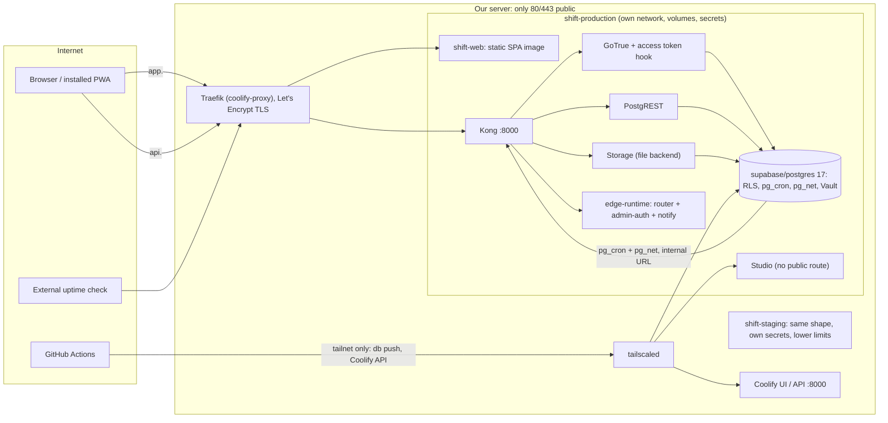

# Sprint Change Proposal: Shift is hosted on our own server through Coolify

- **Date:** 2026-11-20
- **Workflow:** `bmad-correct-course`, run unattended in batch mode. The founder asked for no questions, so every choice below is recorded with its rationale. Anything security-sensitive, costly or needing a credential is listed in §6 as a founder decision with a safe default.
- **Trigger:** founder decision of 2026-11-20. Shift does not use Supabase cloud, Cloudflare Pages or any other hosted service named in `DEPLOY.md`. Everything runs on our own server through Coolify, which already runs on that host.
- **Pilot:** not in production yet. The pipeline has never deployed (`DEPLOY_ENABLED` was never `true`), so there is no live hosted project, Pages project or data to migrate or tear down.
- **Scope classification:** **Moderate to Major.** No product behaviour changes. The deployment target, the deploy pipeline, the operations runbook and five architecture decisions change, and a new epic is added (Epic 20). It needs an Architect review of the amendments applied in this branch (§5.2), plus founder decisions before anything touches the host.

---

## 1. Issue Summary

### 1.1 What the plan assumes today

| Where | What it assumes |
| --- | --- |
| Spine, *Structural Seed → Containers and environments* | One **Supabase project** per environment (Supabase-managed PostgREST, Auth, Storage, Postgres), and a **static host / CDN** for the SPA. Staging is a "free-tier project". |
| Spine, *Stack* | `PostgreSQL — Supabase-managed`. |
| AD-14 (+ 10.1, retro-10 amendments) | Exactly two Edge Functions (`admin-auth`, `notify`) on Supabase's hosted Edge Functions. The pg_cron job `notify` POSTs every minute to the URL in Vault (`notify_url`, documented as `https://<ref>.supabase.co/functions/v1/notify`) with the invoke secret from Vault. |
| AD-17 (+ 10.1, 10.4 amendments) | `sb_publishable_*` in the SPA, `sb_secret_*` only in the functions' per-project secrets (`supabase secrets set`). The legacy `anon`/`service_role` JWT keys are "deprecated at the end of 2026 and are not used". |
| AD-10 / AD-16, DEPLOY §5.2a–b | The custom access token hook (`pg-functions://postgres/public/custom_access_token_hook`, created by `0003`) and the signup switches are configured remotely by `supabase config push` from `supabase/config.toml`, after `db push`, never before. |
| `0001`, `0042` | `pg_cron`, `pg_net` (schema `extensions`), `supabase_vault`, `pgcrypto`, `btree_gist` exist in the database. |
| `0005` | Supabase Storage holds organization logos (bucket inserted by the migration). |
| `DEPLOY.md` §2–§4, §8 | Two free-plan Supabase projects; `supabase link`/`db push`/`config push`/`secrets set`/`functions deploy` with a Supabase access token; Cloudflare Pages by Direct Upload (`wrangler pages deploy`); `_redirects` and `_headers` in Cloudflare's format; HSTS left to Cloudflare's zone. |
| `.github/workflows/pipeline.yml`, `.github/actions/deploy/action.yml` | `deploy-staging → smoke-staging → deploy-production (approval) → smoke-production`, gated by `vars.DEPLOY_ENABLED == 'true'`. Project URL derived as `https://$SUPABASE_PROJECT_REF.supabase.co`. Credentials: `SUPABASE_ACCESS_TOKEN`, `SUPABASE_DB_PASSWORD`, `SUPABASE_SECRET_KEY`, `RESEND_API_KEY`, `NOTIFY_INVOKE_SECRET`, `VAPID_PRIVATE_KEY`, `CLOUDFLARE_API_TOKEN`, all as GitHub Environment secrets. |
| Code | `sb_publishable_` / `sb_secret_` prefix checks in `apps/web/src/lib/supabase/client.ts`, `scripts/ci/require-config.mjs`, `scripts/ci/write-local-env.mjs`, `supabase/functions/admin-auth/handler.ts`, `supabase/functions/notify/handler.ts`. |
| v2 proposal (`sprint-change-proposal-2026-11-20-v2-scope.md`) | D-S4: Resend as Supabase Auth's custom SMTP. Two more Edge Functions (`calendar-feed`, `remind`) and two more cron jobs. Signup opens on "the production project" (D-S5). |

### 1.2 The problem

Every deploy instruction, the CI deploy jobs and five architecture decisions name a hosted platform the founder has ruled out. The rules those decisions protect (no server tier, one place for the secret key, the hook ordering, notifications through pg_cron and Vault) still hold, but where each piece runs and how it is configured changes. A self-hosted stack also brings duties the hosted one carried for us: firewalling, TLS, key generation, backups, updates and monitoring.

**Issue type:** strategic change by the stakeholder (hosting and cost model), not a defect.

### 1.3 Evidence: the host as inspected (read-only, 2026-11-20)

This repository is public, so this section records only what planning needs. The exact listening ports, firewall rules, SSH settings, addresses and tailnet names observed were reported to the founder directly and are deliberately not written here; story 20.4 re-inspects them on the host before changing anything.

| Fact | Observed |
| --- | --- |
| OS / Docker | A current Ubuntu LTS, a current Docker Engine |
| Size | 4 vCPU, 15 GiB RAM (about 4.8 GiB used, 10 GiB available), **no swap**, 171 GB free |
| Coolify | 4.7.6, data in `/data/coolify`; no applications, services or databases yet; no backups configured; **automatic Coolify updates on** |
| Proxy | Coolify's Traefik v3 on 80/443 (TCP, and UDP for HTTP/3) |
| Tailscale | running on the host, with host networking |
| Firewall | ufw inactive; `DOCKER-USER` holds only a rule for the local dev stack's ports |
| Updates | unattended OS upgrades enabled |
| Resident memory now | Coolify with its db, redis, proxy and sentinel ≈ 0.5 GiB; the full local dev Supabase stack ≈ 1.6 GiB, of which analytics ≈ 0.54 GiB and realtime ≈ 0.2 GiB |

**Exposure findings exist that stand on their own, whatever is decided here.** Administrative endpoints and SSH are not yet restricted the way H-2 to H-5 require. Nothing was changed by this workflow, which was read-only as the brief required. The details went to the founder out of band. Closing them is the first item of story 20.4, and H-4 is recommended for ratification even if nothing else here is.

---

## 2. Checklist Record

| Item | Status | Finding |
| --- | --- | --- |
| 1.1 Trigger | [x] | Founder decision 2026-11-20 (no story triggered it) |
| 1.2 Problem | [x] | Strategic change of hosting target; §1.2 |
| 1.3 Evidence | [x] | Spine, DEPLOY.md, pipeline, config.toml, functions, migrations, read-only host inspection (§1.3) |
| 2.1 Current epic | [N/A] | No epic is in progress (14 and 15 done; 16–19 backlog) |
| 2.2 Epic-level change | [x] | **New Epic 20**, self-hosting (§5.3) |
| 2.3 Remaining epics | [!] | Epics 16, 17, 19 deploy new functions, cron jobs and Auth settings; each now targets the self-hosted stack (§3.4) |
| 2.4 Obsoleted / new | [x] | Nothing obsolete. Epic 20 is new |
| 2.5 Order | [!] | Epic 20 gates the pilot's production go-live; it runs before or alongside 16.1 and Epic 18, which need no hosting |
| 3.1 PRD | [!] | No hosting, recovery or exposure NFR exists. Four proposed (NFR-31–34, §5.1), applied on ratification |
| 3.2 Architecture | [!] | AD-10, AD-14, AD-17, Stack, Containers and environments, Conventions, Deferred. **Applied in this branch** as "Amended 2026-11-20 (self-hosting)" clauses (§5.2) |
| 3.3 UX | [N/A] | No surface changes |
| 3.4 Other artifacts | [!] | `DEPLOY.md` (rewrite of §0, §2–§4, §5, §8), `pipeline.yml` deploy jobs, `.github/actions/deploy`, `scripts/ci/*`, `supabase/config.toml` comments, `test/supabase-scaffold.test.ts`, `test/key-hygiene.test.ts`, `smoke/`, `apps/web/public/_headers` and `_redirects`, `deferred-work.md` (CSP, HSTS) |
| 4.1 Direct adjustment | **Viable** | Add Epic 20; amend the spine; v2 stories keep their content and change their deploy target |
| 4.2 Rollback | Not viable / not needed | Nothing was ever deployed |
| 4.3 MVP review | Not needed | No product scope changes |
| 5 Proposal | [x] | This document |

---

## 3. Impact Analysis

### 3.1 The target

**One Coolify instance on this host runs two isolated Shift environments, `shift-staging` and `shift-production`. Each is a self-hosted Supabase stack plus a static SPA. Only Traefik (80/443) faces the internet.**

| Piece | Today's plan | Target |
| --- | --- | --- |
| Postgres | Supabase-managed | `supabase/postgres` image (17.x, same line the CLI runs locally) in the environment's stack. `pg_cron`, `pg_net`, `supabase_vault`, `pgcrypto`, `btree_gist` ship in that image, so `0001` and `0042` apply unchanged |
| Auth | Supabase Auth, configured by `config push` | GoTrue in the stack, configured by environment variables in the stack's compose file: `GOTRUE_DISABLE_SIGNUP=true`, `GOTRUE_EXTERNAL_EMAIL_ENABLED=true`, `GOTRUE_EXTERNAL_ANONYMOUS_USERS_ENABLED=false`, `GOTRUE_MAILER_AUTOCONFIRM=true`, `GOTRUE_JWT_EXP=3600`, refresh rotation and reuse interval, `GOTRUE_PASSWORD_MIN_LENGTH=10`, `GOTRUE_SITE_URL` / `GOTRUE_URI_ALLOW_LIST` from the environment's origins, and `GOTRUE_HOOK_CUSTOM_ACCESS_TOKEN_ENABLED=true` with `GOTRUE_HOOK_CUSTOM_ACCESS_TOKEN_URI=pg-functions://postgres/public/custom_access_token_hook`. A test pins these against `config.toml`, replacing what `config push` guaranteed |
| PostgREST | hosted | in the stack. `PGRST_DB_SCHEMAS=public,graphql_public`, `PGRST_DB_EXTRA_SEARCH_PATH=public,extensions`, `PGRST_DB_MAX_ROWS=1000`, pinned like `[api]` |
| Gateway | hosted | Kong in the stack, the only public route into it, at `api.<domain>`. **Studio's catch-all dashboard route is removed from Kong's config** |
| Edge Functions | hosted Edge Functions | the stack's `edge-runtime`, running a CI-built image `shift-functions` that holds `admin-auth`, `notify` (later `calendar-feed`, `remind`) and a small **router** (`main`) that enforces each function's `verify_jwt` from `config.toml` by asking GoTrue for the user, and holds no key (AD-14 amendment) |
| Storage | hosted | storage-api with the **file** backend on a named volume (logos only). No MinIO, no imgproxy |
| Not deployed | — | Realtime (spine: no subscriptions), Logflare analytics and Vector (heavy; logs are read with `docker logs` through Coolify), Supavisor (PostgREST pools; pilot scale), MinIO, imgproxy, the mail catcher |
| Studio | hosted dashboard | in the stack, **no domain and no Kong route**; bound to `127.0.0.1` and published to the tailnet with `tailscale serve`, or started only when needed |
| SPA | Cloudflare Pages | `shift-web` image: the Vite build for that environment (built in CI, exactly as today) on a pinned non-root static server, with the SPA fallback, `_headers`' headers, `Cache-Control: no-cache` for `index.html` and `sw.js`, immutable `/assets/*`, and HSTS. Coolify runs it at `app.<domain>`; Traefik terminates TLS with Let's Encrypt |
| Cron → `notify` | `notify_url` = public functions URL | `notify_url` = **`http://supabase-kong:8000/functions/v1/notify`**, the stack's internal network. The call never leaves the host, and nothing about it is public |
| Migrations | `supabase link` + `db push` with a Supabase token | `supabase db push --db-url` and `supabase migration list --db-url` from CI, over the **tailnet**: Postgres is bound to `127.0.0.1:<env port>` only and published to the tailnet with `tailscale serve --tcp`. **Never a public Postgres port** |

**How a migration is applied.** CI joins the tailnet as an ephemeral node tagged `tag:ci` (`tailscale/github-action`, an OAuth client the founder creates). The Tailscale ACL lets `tag:ci` reach only the host's two Postgres ports and the Coolify API. The job then runs `supabase db push --db-url "$DB_URL"` and `supabase migration list --db-url "$DB_URL"` with the URL built from Environment values (`DB_HOST` = the MagicDNS name, `DB_PORT`, `SUPABASE_DB_PASSWORD`), followed by `scripts/ci/check-migrations.mjs` as today. A manual promotion does the same from a founder device on the tailnet, or through `ssh -L` over Tailscale SSH. The order rules of DEPLOY §5.2b and §5.2c still hold: the migration before the hook exists in GoTrue's config, and the migration before the SPA that reads it.

**Rejected alternatives:**

- **A one-shot `migrate` container in the stack.** It would remove the tailnet hop, but Coolify does not hold the rest of a deploy on a one-shot container's exit code, so a failed migration would not stop the SPA deploy. That breaks §5.2c.
- **Coolify building the SPA from Git.** It needs Coolify's GitHub App on the repository, and it moves the build, the bundle-secret check and the source-map removal off CI and onto the production host. Building in CI keeps every gate where it is today.
- **A public Postgres port with a password or IP allowlist.** Ruled out by the brief, and GitHub's runner IPs are not a stable allowlist.
- **A self-hosted GitHub runner on the host.** It would put arbitrary workflow code on the production host. Rejected.

### 3.2 Environments and sizing

| Option | For | Against |
| --- | --- | --- |
| **A. Both on this host, two isolated stacks** (recommended) | No new cost. Staging rehearses on the same OS, Docker, Coolify and Traefik that production runs on. One host to secure | Shares the host's failure domain, so staging cannot catch a host-level fault. Needs resource limits so staging cannot starve production |
| B. Staging elsewhere (a second small VPS, about €4–6/month) | Isolation; a host-level change can be rehearsed | A new cost and a second host to harden, patch and monitor. More than the pilot needs |
| C. Staging on demand (stopped between promotions) | Frees about 1 GiB | A promotion has to start it first. Pg_cron and backups are idle in between. Possible later as a tweak of A |

**Isolation in A:** each environment is its own Coolify project and its own Supabase stack, with its own Docker network, volumes, generated secrets, JWT secret, keys, Vault, invoke secret, VAPID pair, domains and GitHub Environment. No container joins the other environment's network. Staging never holds a copy of production data (a restore drill uses a throwaway stack, §3.6).

**Sizing (resident memory, from today's measurements of the same images):**

| Component | Typical | Limit to set |
| --- | --- | --- |
| Postgres (`shared_buffers` 256 MB prod / 128 MB staging) | 0.2–0.5 GiB | 1 GiB / 0.5 GiB |
| Kong | 0.1 GiB | 256 MiB |
| GoTrue, PostgREST | 0.05 GiB | 128 MiB each |
| Storage, postgres-meta | 0.2 GiB | 256 + 128 MiB |
| edge-runtime | 0.05–0.3 GiB | 512 MiB |
| Studio (only while used) | 0.2 GiB | 512 MiB |
| shift-web | < 0.02 GiB | 64 MiB |
| **One trimmed stack** | **≈ 0.8–1.2 GiB** | **≈ 2.9 GiB prod, ≈ 2.2 GiB staging** |
| Coolify, proxy, sentinel, Tailscale | ≈ 0.5 GiB | — |
| The local dev Supabase stack (stays; can be stopped) | ≈ 1.6 GiB | — |
| OS, agents, page cache headroom | ≈ 2–3 GiB | — |
| **Total** | **≈ 5–7 GiB of 15 GiB** | worst case of all limits ≈ 8 GiB |

CPU: 4 vCPU is ample for a pilot of tens of members. Staging's services get CPU limits (1.0 CPU total) so a staging migration or test cannot starve production. Disk: Postgres for the pilot is well under 1 GB; daily dumps compress to a few MB.

**Recommendation: option A**, with trimmed stacks, memory and CPU limits, and a **4 GiB swapfile** (there is none today; H-15) as a guard against an out-of-memory kill of production Postgres during a build or test spike. **Revisit trigger:** a second paying organization, host memory steadily above 75 %, or any production incident caused by a non-production workload on the host. Then production moves to a dedicated VPS (H-14).

### 3.3 Security (summary; each item is a founder decision in §6)

- Only 80/443 public (H-2).
- A host firewall that Docker cannot bypass (H-3): `DOCKER-USER` rules for every published container port on `eth0` (IPv4 and IPv6), and an `INPUT` policy for host services (sshd). Keep the existing dev-stack drop.
- SSH by key only, from the tailnet and Coolify's own bridge only (H-4). **Coolify reaches its own host over SSH from its Docker bridge network**, so an SSH rule that admits only `tailscale0` would cut Coolify off its server. The rule must admit that bridge.
- Studio, Postgres, the Coolify UI and API over Tailscale only (H-5).
- Fresh secrets per stack, never the demo values from Supabase's `docker/.env.example`, never shared between staging and production (H-6).
- Runtime secrets in Coolify, deploy credentials in GitHub, and the two never overlap (H-8).
- The CI deploy uses a Coolify token with deploy permission only, and the tailnet (H-9).
- Pinned images, manual Coolify upgrades, automatic OS security updates (H-10).

### 3.4 Impact on epics, PRD, architecture, CI and DEPLOY.md

**Epics 1–15 (done):** no code is invalidated. The parts that touch deploy are configuration and docs: the key-shape checks (AD-17 amendment), `scripts/ci/*`, the deploy composite action, `_headers`/`_redirects`, `DEPLOY.md`.

**v2 (`sprint-change-proposal-2026-11-20-v2-scope.md`), story by story:**

| v2 item | Effect of self-hosting |
| --- | --- |
| 16.2 domain package under Deno | Easier to prove: the parity suite runs against the **same pinned `edge-runtime` image** that production runs (from 20.1/20.2), not "whatever Supabase runs". 16.2 depends on 20.2 for the image and the router |
| 16.4 `calendar-feed` | Public (`verify_jwt = false`) at `https://api.<domain>/functions/v1/calendar-feed/<token>`. Added to the router's table and to the `shift-functions` image. Logging: the edge-runtime and Kong access logs would contain the token path. **Kong's and Traefik's access logging must redact or drop that path** (NFR-27 "never written to a log in full"), which is now our job, not Supabase's. Added to 16.4's AC through 20.2's router contract |
| 17.2 `remind` | Cron-invoked like `notify`, with an internal URL in Vault (`http://supabase-kong:8000/functions/v1/remind`). The secret key lives in the edge-runtime's Coolify environment |
| D-S4 Resend as Auth SMTP | Still the default, now as GoTrue environment variables in the production stack (`GOTRUE_SMTP_HOST=smtp.resend.com`, port 465, user `resend`, the API key as password, `GOTRUE_SMTP_ADMIN_EMAIL`, `GOTRUE_SMTP_SENDER_NAME`). Auth email is needed only from Epic 19: v1 has no confirmation or recovery mail (AD-12). The SMTP choice is re-asked as H-7 because "the host" is now an option; it is not recommended |
| D-S3 signup rate limits | Hosted Supabase Auth sits behind Supabase's own edge protections; a self-hosted GoTrue does not. Besides `GOTRUE_RATE_LIMIT_*`, 19.1 adds a **Traefik rate-limit middleware** on `/auth/v1/signup`, `/auth/v1/recover`, `/auth/v1/resend` and `/auth/v1/otp`, and trusts `X-Forwarded-For` only from Traefik, so GoTrue's per-IP limits see the client IP and not the proxy's |
| D-S5 signup on the production project | "The production project" becomes the production stack's GoTrue environment in Coolify. The decision itself is unchanged |
| Epic 19 "all four Edge Functions" | Unchanged, with the router as the route into them |
| Hard constraint "no new paid service" | Consistent. The only possible new costs here are the backup target (H-11) and, later, a dedicated production host (H-14), both founder decisions |

**PRD:** §5.1 proposes NFR-31–34 (hosting, recoverability, exposure, monitoring). Applied on ratification, not in this branch, because they set service levels the founder owns.

**Architecture:** §5.2, applied in this branch.

**CI (`pipeline.yml`, `.github/actions/deploy/action.yml`, `scripts/ci/*`):** the job graph and its gates stay (`DEPLOY_ENABLED`, Environments restricted to `main`, production approval, smoke after each deploy, `ci-passed`). The deploy action's steps change (§5.4). `SUPABASE_ACCESS_TOKEN`, `SUPABASE_PROJECT_REF`, `CLOUDFLARE_*`, and the runtime secrets (`SUPABASE_SECRET_KEY`, `RESEND_API_KEY`, `NOTIFY_INVOKE_SECRET`, `VAPID_PRIVATE_KEY`) **leave GitHub**. The runtime secrets live only in Coolify.

**DEPLOY.md:** §0 (no Supabase account token; Tailscale on the operator's device), §2 (Coolify stacks instead of Supabase projects), §3/§3a (where each key goes: the Coolify resource's environment; the Vault `notify_url` is internal), §4 (the `shift-web` image instead of Pages), §5 (`db push --db-url` over the tailnet; the GoTrue environment replaces `config push`; the §5.2b order becomes "migrate, then set or restart GoTrue with the hook"), §6 (verification against our domains), §8 (pipeline), §8.6 (`config push` table replaced by the GoTrue-environment parity test), §8.7 (rollback: redeploy the previous image tag), plus new sections for host security, backups and restore, monitoring and updates. Written story by story in Epic 20; 20.9 removes the last Supabase-cloud and Cloudflare text.

### 3.5 Secrets: where each one lives

| Secret | Lives in | Never in |
| --- | --- | --- |
| Stack JWT signing secret, Postgres password, dashboard password, Vault/meta encryption keys | Coolify's generated environment for that stack (`SERVICE_PASSWORD_*`), encrypted at rest with Coolify's `APP_KEY` | GitHub, the SPA, the functions image, the repo |
| `SUPABASE_DB_PASSWORD` (for `db push`) | **also** a GitHub Environment secret (the one runtime credential CI needs) | repository secrets, logs |
| Secret key (`sb_secret_*` or `service_role` form, AD-17 amendment) | the stack's edge-runtime environment in Coolify, as `SHIFT_SECRET_KEY` | GitHub, the SPA, images |
| Resend key, invoke secret, VAPID private key | the stack's edge-runtime environment in Coolify; the invoke secret also in that stack's Vault | GitHub (removed), the SPA, images |
| Publishable key, VAPID public key, API origin | GitHub Environment **variables** → the `shift-web` build | — (public by design) |
| Coolify API token (deploy scope), Tailscale OAuth client, GHCR pull token | GitHub Environment secrets (the first two); Coolify's registry credentials (the third) | anywhere else |
| Coolify `APP_KEY` (`/data/coolify/source/.env`) | the host, **and an offline copy in the founder's password manager** | backups stored with the data they decrypt |

### 3.6 Backups and recovery

- **Database.** Coolify's scheduled backup of the stack's Postgres (`pg_dump`, custom format), **daily at 02:30 Europe/Zagreb**, local retention 7, S3 retention 30. A manual "backup now" before every production migration. 20.5 verifies that Coolify offers scheduled backups for a database inside a service stack. If it does not, a pinned `pg_dump` sidecar on the stack's network writes to the same local and S3 targets on the same schedule.
- **Storage objects** (logos, file backend volume) and **Coolify's own data**: a nightly `restic` job on the host to the same off-host target. It is small and changes rarely.
- **Off-host target (H-11):** an S3-compatible bucket in the EU with server-side encryption. Default **Backblaze B2, EU Central region, free tier (10 GB)**: the pilot's 30 dailies are a few hundred MB at most, so there is no cost at pilot scale. The founder creates the account and a bucket-scoped application key.
- **Interim until H-11 is decided:** local Coolify backups plus a nightly **pull** over the tailnet to a founder device (`rsync` over Tailscale SSH from the device, read-only on the host side). The host never holds a credential for the copy, so a compromised host cannot delete it. Better than nothing; not a substitute.
- **Vault after a restore.** The two `notify` Vault secrets (and later `remind`'s) are encrypted with the stack's root key, and a restore into a fresh stack cannot decrypt them. The runbook re-creates them from the Coolify environment after every restore. That is a known, two-statement step (DEPLOY §3a).
- **Restore drill:** before go-live and then quarterly. Create a throwaway stack from the same compose, restore the latest **off-host** dump plus the storage snapshot, re-create the Vault secrets, sign in as the smoke account, compare per-table row counts with production at dump time, record the time taken, then destroy the stack. **Never into staging**, which would copy personal data into a less-guarded environment.
- **RPO/RTO for the pilot (H-12):** **RPO ≤ 24 h** (daily dump; ≤ 0 for a planned migration thanks to the pre-push backup). **RTO ≤ 4 h** on the same host and **≤ 1 working day** on a new host (new VPS, Coolify install, compose, restore, DNS). Continuous WAL archiving (point-in-time recovery) is deferred (§5.2, Deferred).
- **Provider snapshots** (the VPS provider's own backups) can be a further layer but are not counted, because they share the provider's failure domain and restore the whole disk, secrets included.

### 3.7 Single point of failure and monitoring

The host is the single point of failure for the app, the API, the database and the backups' first copy. For a pilot of one fire department that is accepted, on three conditions: off-host backups (§3.6), a rehearsed restore with a known RTO, and someone hearing about an outage. The host also runs development and agent workloads (the local Supabase stack, worktrees, other projects). That widens the blast radius and is H-14.

**Monitoring (H-13):**

- An **external** uptime check (the host cannot report its own death). Default: **UptimeRobot free plan** (5-minute HTTP checks, e-mail alerts, no cost) on `https://app.<domain>/` (200 with the SPA shell), `https://api.<domain>/auth/v1/health` (200), and a keyword check on `https://api.<domain>/functions/v1/notify` answering `401 INVOKE_SECRET_REFUSED`, which proves Kong, edge-runtime and the router are up without a credential. It is a new third party at no cost. **Fallback without a new provider:** a GitHub Actions scheduled workflow every 30 minutes (about 1,500 runner minutes a month; this fits the free private-repo quota only if CI usage leaves room, so it is a fallback).
- **Coolify notifications** (e-mail through the chosen SMTP, or Telegram/Discord) for failed backups, failed deploys, stopped containers and high disk use (Sentinel is already running).
- **Notification backlog**: a staff-only probe later (outbox rows unsettled for more than 30 minutes). Recorded as deferred-work and not in this epic.

---

## 4. Recommended Approach

**Direct adjustment:** keep every product rule and every CI gate, change the deploy target, and add **Epic 20** with nine stories. Four of them can be built now from the repository alone (20.1–20.4's code and scripts). The rest wait for founder inputs (§6, §7).

- **Effort:** medium. About 3 code stories, 1 host-script story and 5 stand-up/ops stories.
- **Risk:** medium. The main risks are firewall lockout while applying H-3/H-4 (mitigated: apply from the provider's console with a timed auto-revert), self-hosted key format (resolved by 20.1's probe, AD-17 amendment), and drift between the compose file and Coolify's copy (mitigated: the repository's compose file is the source, pasted or pushed by API, never hand-edited in Coolify).
- **Timeline impact:** the pilot's go-live now waits for Epic 20 (it would have waited for hosted setup anyway). Epics 16.1 and 18 are unaffected and can proceed in parallel.

**Recommended order:** 20.1 → 20.2 → 20.3 (code, now) and 20.4's scripts (now). Then, once the founder has decided: apply 20.4 → 20.5 staging → 20.6 pipeline → 20.7 backups → 20.8 monitoring → 20.9 production.

---

## 5. Detailed Change Proposals

### 5.1 PRD (`prds/prd-shift-2026-09-01/prd.md` §8), applied on ratification

New subsection **"Operations (added 2026-11-20, self-hosting)"**:

- **NFR-31.** Every production component (database, auth, API, functions, file storage, the web app) and the first copy of every backup runs on infrastructure the operator controls. Off-host backup copies are encrypted at rest and stored in the EU. No component depends on a hosted application platform.
- **NFR-32.** Data loss after a host failure is at most 24 hours of writes (RPO). Service is restored within 4 hours on the same host and within one working day on a new host (RTO). A restore from the off-host copy is rehearsed before go-live and quarterly, and its duration is recorded.
- **NFR-33.** Only HTTPS (443) and its HTTP redirect (80) are reachable from the internet. Database, administration consoles and the deployment API are reachable only over the private network.
- **NFR-34.** An outage of the web app or the API is detected by a check outside the host and reported to the operator within 10 minutes.

### 5.2 Architecture spine, **applied in this branch**

Each change below is added as an **"Amended 2026-11-20 (self-hosting)"** clause. No earlier text is deleted, as is the spine's convention.

| Section | Amendment (summary) |
| --- | --- |
| Front matter | `updated: '2026-11-20'` |
| AD-10 | The access token hook is enabled by GoTrue's environment in the stack's compose file, not by `config push`. The order rule holds unchanged: the migration that creates the function lands first. A test pins the compose's GoTrue values to `config.toml` |
| AD-14 | The static SPA is served by a CI-built static image behind Coolify's Traefik with TLS. The functions run on the stack's pinned `edge-runtime`, behind a router (`main`) that is platform plumbing: it holds no key, reads no table, serves only the functions named in `config.toml`, and enforces each one's `verify_jwt` by asking GoTrue. It is not counted as an Edge Function. Cron calls reach functions on the stack's internal network |
| AD-17 | Per-environment secrets live in that stack's Coolify environment. The JWT signing secret is fresh per stack and held only by the stack's own services, never by the functions container, GitHub or the SPA. Key form: opaque `sb_` keys where the pinned stack supports them, otherwise the stack's `anon`/`service_role` JWTs, with shape guards that check the role claim (the SPA accepts only `anon`). GitHub holds deploy credentials only, plus the database password for `db push` |
| Stack | Rows for Coolify, the self-hosted Supabase images (pinned in the compose file, Postgres 17 as locally), Traefik, the static server |
| Consistency Conventions | Migrations are applied with `supabase db push --db-url` over the tailnet; never through a public port |
| Structural Seed → Containers and environments | The new container diagram and the environment flow (local → staging stack → production stack on one host) |
| Deferred | Dedicated production host; point-in-time recovery (WAL archiving); multi-host high availability; Realtime, analytics and pooler services |

### 5.3 Epics (`epics.md`) and sprint status, **applied in this branch**

**Epic 20: Shift runs on our own server, and comes back from a backup.**

The epic is numbered after the v2 epics 16–19. Its stories in order, with what can be done now:

| Story | Content | Now / blocked |
| --- | --- | --- |
| **20.1 The self-hosted stack is defined in the repository** | `deploy/coolify/supabase/docker-compose.yml`, derived from Coolify's Supabase service template at a recorded commit and trimmed (§3.1), with images pinned to the versions the CLI runs locally. GoTrue and PostgREST environment mirrors `config.toml`. Postgres and Studio are bound to `127.0.0.1`. No Studio route in Kong. Resource limits per environment. The Storage file backend. Tests: GoTrue/PostgREST parity with `config.toml`; no service publishes on `0.0.0.0`; every image pinned by version. A local run under its own project name and ports (never touching the dev stack) applies all migrations with `db push --db-url`, signs in through the hook, and reaches Storage. **Records the key-form probe** that settles AD-17's two branches | **Now** (code and docs) |
| **20.2 Edge Functions run on the self-hosted runtime behind a keyless router** | The router (`deploy/functions/main`), driven by `config.toml`'s `[functions.*]` table; `verify_jwt` checked by GoTrue `GET /auth/v1/user`; unknown function → 404; it holds no key. The `shift-functions` image (pinned `edge-runtime` base, functions copied, dependencies cached at build time so a cold start fetches nothing). Key-shape guards per AD-17's branch. `SUPABASE_URL` is the internal Kong URL. The access log redacts the path after `/functions/v1/calendar-feed/` (ready for 16.4). Tests: router unit tests; `admin-auth` and `notify` through the router in the 20.1 local stack, including `401 INVOKE_SECRET_REFUSED` | **Now** (code); after 20.1 |
| **20.3 The SPA ships as a static image with its headers** | `deploy/web/Dockerfile` (pinned non-root static server). `_redirects`/`_headers` become the server's config, with a test that the headers served equal `_headers`. `Cache-Control` for `index.html`, `sw.js`, `/assets/*`. HSTS. A CSP derived at build time from `VITE_SUPABASE_URL`: drafted here, enforced only after staging verifies it (closes the `deferred-work.md` CSP and HSTS entries in 20.5). The source maps are still removed | **Now** (code); CSP enforcement verified in 20.5 |
| **20.4 The host is closed to everything but the web** | Idempotent scripts and a runbook in `deploy/host/`: the `DOCKER-USER` policy (IPv4 and IPv6: on `eth0` allow established, 80, 443/tcp+udp; drop the rest), the `INPUT` policy (sshd from `tailscale0` and Coolify's Docker bridge), the sshd drop-in (`PermitRootLogin prohibit-password`, `PasswordAuthentication no`, ordered ahead of any cloud-init drop-in), a systemd unit that re-applies the rules after Docker starts, the swapfile, Coolify auto-update off, and a verification script (an outside port scan shows only 80/443). Applied **from the provider's console with a timed auto-revert** | Scripts **now**; applying is **blocked on** H-2, H-3, H-4, H-5, H-10, H-15 |
| **20.5 Staging stands up on Coolify** | Coolify project `shift-staging`: the 20.1 compose; fresh generated secrets, checked as not demo values; domains `staging.<domain>` and `api.staging.<domain>` with Let's Encrypt; `tailscale serve` for its Postgres; first `db push` over the tailnet, then GoTrue with the hook (§5.2b order); Vault `notify_url` (internal) and invoke secret; the edge-runtime environment; the smoke organization (DEPLOY §7); the `shift-web` image; CSP verified then enforced; DEPLOY.md sections for all of it | **Blocked on** DNS for staging, H-1, H-6, H-8, the Tailscale ACL; 20.1–20.4 |
| **20.6 The pipeline deploys through Coolify** | The deploy action rewritten (§5.4); `require-config.mjs` for the new set; GHCR images tagged by commit; the Coolify API (deploy-scoped token) deploys the image; `db push` over the tailnet; probes and smoke unchanged in intent; rollback = redeploy the previous tag; `DEPLOY.md` §8 rewritten | Code **now**; enabling **blocked on** the Coolify API token, the Tailscale OAuth client, the GHCR pull token, 20.5 |
| **20.7 Backups leave the host, and a restore is rehearsed** | Coolify scheduled backups (or the sidecar), `restic` for storage and Coolify data, the off-host target, alerting on failure, the restore runbook, the first drill with its measured RTO. Interim local backups plus the tailnet pull as soon as 20.5 exists | Interim after 20.5; off-host **blocked on** H-11, H-12 and the target's credential |
| **20.8 Someone hears when Shift is down** | External uptime checks (§3.7), Coolify notifications, a runbook for "the site is down" | **Blocked on** H-13 (and SMTP or a chat channel for Coolify) |
| **20.9 Production stands up, and DEPLOY.md is the self-hosting runbook** | As 20.5, for `shift-production`, with the production approval gate; Resend production domain; first production `db push` outside working hours; provisioning of the pilot organization (DEPLOY §7); backups and monitoring verified on production; a restore drill passed; `DEPLOY.md` free of Supabase-cloud and Cloudflare instructions; `DEPLOY_ENABLED=true` | **Blocked on** everything above, production DNS, the Resend domain and key, the founder's go |

Sprint status: `epic-20: backlog`, nine story keys `backlog`, each with a `waits:` note; `epic-20-retrospective: optional`. Inserted by hand after Epic 19.

### 5.4 CI and `DEPLOY.md` (applied by 20.6 and the stand-up stories)

The new deploy action, in order (each step replaces the like-numbered step of DEPLOY §8.1):

1. `require-config.mjs` checks: `APP_ORIGINS`, `SUPABASE_API_URL` (https, our domain), `SUPABASE_PUBLISHABLE_KEY` (AD-17 shape), `VAPID_PUBLIC_KEY`, `DB_HOST`, `DB_PORT`, `SUPABASE_DB_PASSWORD`, `COOLIFY_API_URL` (tailnet), `COOLIFY_API_TOKEN`, `COOLIFY_WEB_UUID`, `COOLIFY_FUNCTIONS_UUID`, `TS_OAUTH_CLIENT_ID`, `TS_OAUTH_SECRET`;
2. join the tailnet (ephemeral, `tag:ci`);
3. a pre-push backup through the Coolify API (production only, if 20.5 finds the endpoint; otherwise a documented manual step before approving);
4. `supabase db push --db-url`, then `migration list --db-url` + `check-migrations.mjs`;
5. the GoTrue environment is **not** pushed by CI; its parity with `config.toml` is a test that runs in `test` on every PR, and a change to it is a reviewed change of the compose file, applied in Coolify by the operator (20.6 may automate this through the API later);
6. build and push `shift-functions:<sha>`; Coolify redeploys the stack's edge-runtime with that tag; probe `notify` → `401 INVOKE_SECRET_REFUSED`;
7. build `apps/web` with that environment's `VITE_*`; the bundle check (`sb_secret_`, any JWT whose role is not `anon`, `re_`, a VAPID private key shape); remove `*.map`;
8. build and push `shift-web:<env>-<sha>`; Coolify deploys it;
9. outputs for the smoke: app origin, API URL, publishable key.

### 5.5 UX

None.

---

## 6. Founder decisions

Each has a recommended **default**. Planning proceeds on the defaults. A story that depends on one does not start until it is ratified. Ratification can be one line ("H defaults approved").

| Id | Decision | Recommended default | Why, and the alternative |
|---|---|---|---|
| **H-1** | Topology | **Staging and production on this host as two isolated Coolify stacks**, trimmed, with limits (§3.2) | No new cost; same platform as production. Alternative: staging on a second VPS (about €4–6/month) |
| **H-2** | Public exposure | **Only 80/tcp and 443/tcp+udp public.** The Coolify UI and API, its realtime and terminal ports, Traefik's dashboard port and SSH are reachable only over Tailscale | Alternative: the Coolify UI behind Traefik with TLS on a domain. Not recommended, because it keeps a root-equivalent console on the internet |
| **H-3** | Host firewall | **`DOCKER-USER` default-drop on `eth0` except established, 80, 443** (IPv4 and IPv6), keeping the existing dev-stack drop; **`INPUT`** (ufw or nftables) for host services; re-applied by a systemd unit after Docker starts; applied from the provider console with a 5-minute auto-revert | ufw alone does not filter Docker-published ports. Risk: a lockout, mitigated by the console and the auto-revert |
| **H-4** | SSH | **Key-only (`PasswordAuthentication no`), `PermitRootLogin prohibit-password`** (Coolify logs in as root by key), reachable from `tailscale0` and Coolify's Docker bridge only | Recommended even if nothing else here is approved (§1.3). Alternative: a non-root sudo user for Coolify (Coolify supports it with caveats) |
| **H-5** | Studio and Postgres | **Tailscale only.** No Kong route to Studio; Postgres on `127.0.0.1` + `tailscale serve --tcp`; Tailscale ACL limits them to the founder's devices and `tag:ci` | The self-hosted default serves Studio behind basic auth on the public API domain. Alternative: an SSH tunnel only, with no `tailscale serve` |
| **H-6** | JWT secret and keys | **Fresh per stack, generated by Coolify, checked as not the demo values from Supabase's `.env.example`, never shared between staging and production**; rotation is a runbook step (it signs everyone out) | The public demo JWT secret would let anyone mint a `service_role` token. No alternative is safe |
| **H-7** | SMTP | **Resend** (existing account and domain; free tier 3,000/month, 100/day): its HTTP API for `notify` as today, and SMTP for GoTrue from Epic 19 (D-S4) | **Another provider** (Brevo, Amazon SES, Mailjet) needs a change to `notify/email.ts`, which is Resend's API. **The host's own MTA**: rejected; a fresh VPS IP has no sending reputation, port 25 is often blocked, and SPF/DKIM/DMARC and bounces become ours |
| **H-8** | Secrets handling | **Runtime secrets only in the Coolify resource that reads them** (encrypted with Coolify's `APP_KEY`); **deploy credentials only in GitHub Environments**; the Coolify `APP_KEY` copied offline to the founder's password manager; no secret in a build variable; staging and production never share a value | Coolify's environment is readable by any Coolify admin, so Coolify accounts get 2FA and there is one admin account. Alternative: an external secret manager, which is a new service. Not needed at this scale |
| **H-9** | CI deploy | **GitHub Actions → GHCR images → Coolify API with a token limited to deploy**, over the tailnet; the production approval gate stays | Needs three founder-made credentials: the Coolify token, a Tailscale OAuth client, a GHCR read token for Coolify. Alternative: Coolify webhooks plus Coolify's GitHub App building from Git. That moves builds and the bundle checks onto the production host |
| **H-10** | Update policy | **OS:** unattended security upgrades on (as today), automatic reboot off, a monthly maintenance window (kernel reboot, Docker). **Coolify:** auto-update **off** (today on); upgrade by hand in the window, after a backup and reading the release notes. **Supabase images:** pinned; upgraded by a PR, staging first, then production. **Tailscale:** auto-update on | An unattended Coolify upgrade can restart the proxy and every stack at night, with no one watching. Alternative: leave Coolify auto-update on with a weekly frequency |
| **H-11** | Backup target (a cost decision) | **Backblaze B2, EU Central region, free tier (10 GB), server-side encryption on, a bucket-scoped key**; until decided, the **interim** local backups plus a nightly Tailscale pull to a founder device | Alternatives: Hetzner Object Storage (about €5/month, EU), Cloudflare R2 (free 10 GB, but Cloudflare), a founder NAS reached over Tailscale (no cost, a home device) |
| **H-12** | RPO / RTO | **RPO ≤ 24 h** (daily 02:30 plus a pre-migration backup), **RTO ≤ 4 h same host / ≤ 1 working day new host**, a restore drill before go-live and quarterly | Alternative: 6-hourly dumps (still free), or WAL archiving for minutes of RPO (deferred, needs more storage and care) |
| **H-13** | Uptime monitoring | **UptimeRobot free**, three checks (§3.7), alerts to the founder's e-mail; Coolify notifications on | A new third party at no cost. Alternative without one: a GitHub Actions schedule every 30 minutes |
| **H-14** | Development and agent workloads on the production host | **Accept for the pilot**, with limits: production stacks have memory/CPU limits; agents never operate Coolify or the production stacks; the dev stack keeps its ports dropped. **Revisit** at a second organization, sustained memory above 75 %, or any incident: then production moves to a dedicated VPS (a cost decision then) | One shared root host is the biggest residual risk. Alternative now: a dedicated small VPS for production (about €5–10/month) |
| **H-15** | Swap | **A 4 GiB swapfile, `vm.swappiness=10`** | There is no swap today, so a memory spike kills a process (possibly Postgres) instead of slowing down |

---

## 7. What the founder must provide

| Item | Needed by | Notes |
|---|---|---|
| Ratification of H-1 to H-15 (or amendments) | 20.4 onward | One line is enough |
| **A domain and DNS** for the app and the API, in both environments: `app.<domain>`, `api.<domain>`, `staging.<domain>`, `api.staging.<domain>` (A, and AAAA if wanted, to the server's public addresses) | 20.5 (staging), 20.9 (production) | The names are a default; any four names work. A `CAA` record for Let's Encrypt is optional |
| **SMTP / Resend:** the Resend account, a verified sending domain (SPF, DKIM, bounce MX records), a sending-only API key per environment, the sender address | 20.5 (staging e-mail), 20.9 | Reused for GoTrue SMTP in Epic 19 (D-S4) |
| **A Coolify API token** per environment, with deploy permission only | 20.6 | Stored only as a GitHub Environment secret |
| **A Tailscale OAuth client** (or an ephemeral, reusable, tagged auth key) for `tag:ci`, and the tailnet ACL that limits `tag:ci` to the Postgres ports and the Coolify API | 20.5 (ACL), 20.6 | The founder owns the tailnet |
| **A GHCR read token** for Coolify to pull the private images (a classic PAT with `read:packages` only, or a machine user's) | 20.5 | Stored in Coolify's registry credentials |
| **A backup target**: the B2 (or chosen) account, a bucket in the EU, a bucket-scoped key; or a device on the tailnet for the interim pull | 20.7 | H-11 is a cost decision |
| **An uptime-monitor account** (H-13) and where alerts go | 20.8 | |
| **Console access** to the VPS provider during 20.4 | 20.4 | The lockout fallback |
| **Go** for applying the host changes (20.4) and for production (20.9) | 20.4, 20.9 | Security-sensitive changes to the host this workspace runs on |

---

## 8. Implementation Handoff

- **Scope:** Moderate to Major (new epic, architecture amendments, no product change).
- **Founder (now):** ratify §6 H-1 to H-15; supply §7 as each story needs it. Nothing in Epic 20 touches the host, Coolify or any credential before that.
- **Architect** (`bmad-architecture`, update intent): review the self-hosting amendments applied to the spine in this branch, especially AD-17's two key-form branches, which 20.1 settles by probe.
- **PM:** apply NFR-31–34 to the PRD on ratification. Update the project memory note.
- **Developer** (`bmad-build`), now: 20.1, 20.2, 20.3, and 20.4's scripts (not their application). Each updates `DEPLOY.md` for what it ships and keeps `test/supabase-scaffold.test.ts` and `test/key-hygiene.test.ts` green.
- **Operator (founder, with a developer):** 20.4's application, then 20.5–20.9 as inputs arrive.
- **Security:** a `security-review` of 20.2 (the router decides which function needs a session) and of 20.4's rules before they are applied.

**Success criteria:**

- an outside port scan of the server's IPv4 and IPv6 addresses shows only 80 and 443;
- `api.<domain>` serves no Studio, and Postgres answers only on the tailnet;
- no secret in GitHub can sign a token, and the SPA bundle carries only the anon-role key;
- a decoded staging token carries `organization_id` (the hook runs) and a signup probe is refused;
- the `notify` cron reaches the function on the internal URL, and the outbox drains;
- a restore of the latest off-host backup into a throwaway stack signs in the smoke account, within the RTO;
- the external check alerts within 10 minutes of stopping `shift-web`;
- `DEPLOY.md` contains no instruction for Supabase cloud or Cloudflare.

## 9. Open risks

1. **Self-hosted key format.** Whether the pinned self-hosted stack accepts opaque `sb_publishable_`/`sb_secret_` keys is not verified. 20.1 probes it, and AD-17's amendment covers both outcomes.
2. **Drift between the repository's compose file and Coolify's copy.** It is mitigated by making the repository the source and reviewing every change, and by a later API-driven sync. Coolify's template upgrades are not taken automatically.
3. **Coolify backups for a database inside a service.** To be verified in 20.5. The fallback is the `pg_dump` sidecar.
4. **Shared root host** (H-14).
5. **IPv6.** Docker publishes on `[::]`; every rule in 20.4 is written for both families, and the verification scans both.
6. **Let's Encrypt rate limits** during repeated stand-ups. Staging uses its own names, and failures are retried, not looped.
